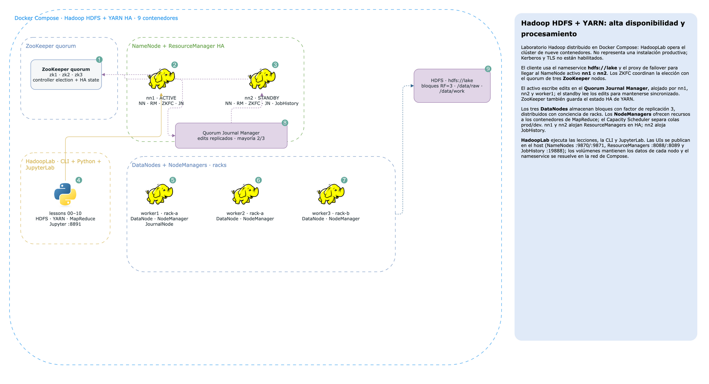

# Hadoop HDFS and YARN Architecture

Laboratorio para entender **Hadoop distribuido**: almacenamiento con HDFS, alta disponibilidad con dos NameNodes y
JournalNodes, elección automática con ZooKeeper, ejecución de trabajos con YARN y MapReduce, tolerancia a fallos,
topología de racks y herramientas para operar datos a escala.

El caso común son 1.000 medidores inteligentes de una distribuidora colombiana: 30 días de lecturas, catálogo,
clima e inspecciones. Los mismos datos sintéticos aparecen en los laboratorios de Kafka y Spark.

## Arquitectura



> Diagrama editable: [`docs/architecture.drawio`](docs/architecture.drawio).

| Servicio | Responsabilidad |
| --- | --- |
| `nn1`, `nn2` | NameNode activo/standby, ZKFC; ResourceManager `rm1`/`rm2`; `nn2` también aloja JobHistory |
| `worker1` | DataNode, NodeManager y JournalNode, rack-a |
| `worker2` | DataNode y NodeManager, rack-a |
| `worker3` | DataNode y NodeManager, rack-b |
| `zk1`–`zk3` | Quórum ZooKeeper para las elecciones de HDFS y YARN |
| `HadoopLab` | CLI de Hadoop, cliente Python, scripts MapReduce y JupyterLab |

HDFS replica cada bloque en tres DataNodes y procura distribuir las réplicas entre racks. Los NameNodes comparten
edits mediante QJM (`qjournal`); los ZKFC eligen el activo. YARN persiste el estado de las aplicaciones en ZooKeeper.
El Capacity Scheduler tiene dos colas: `prod` (70 % garantizado) y `dev` (30 %), con capacidad elástica y preemption.

## Requisitos

- Docker Desktop con Compose y **10 GB o más asignados a Docker**. El clúster incluye 9 contenedores y demanda memoria.
- Puertos libres: `9870`, `9871`, `8088`, `8089`, `19888`, `8891`.
- La imagen oficial Hadoop se ejecuta como `linux/amd64`; en Apple Silicon Docker usa emulación.

## Puesta en marcha

Desde `.docker/`:

```bash
docker compose -f docker-compose.yml -f hadoop.yml up -d --build
docker exec HadoopLab .docker/entrypoint.sh
```

En el laboratorio, ejecuta las lecciones en orden:

```bash
python lessons/00_seed.py
python lessons/01_hdfs_architecture.py
# continuar con lessons/02...10 en orden
```

`00_seed.py` regenera `/data/raw`. Los volúmenes de datos son persistentes; `docker compose down` los conserva.
No uses `down -v` salvo que quieras borrar el estado del laboratorio.

| Interfaz | URL desde el host |
| --- | --- |
| NameNode 1 / 2 | `http://localhost:9870` / `http://localhost:9871` |
| ResourceManager 1 / 2 | `http://localhost:8088` / `http://localhost:8089` |
| MapReduce JobHistory | `http://localhost:19888` |
| JupyterLab | `http://localhost:8891` |

El proyecto usa la subred Docker `172.30.0.0/24` para conservar las direcciones y la resolución DNS entre nodos
durante las pruebas de failover. Si esa subred ya está ocupada, cambia el bloque `ipam` y las IPs relacionadas en
`.docker/hadoop.yml` y `.docker/docker-compose.yml`.

Para parar los contenedores sin borrar los datos:

```bash
docker compose -f docker-compose.yml -f hadoop.yml stop
```

## Lecciones

| # | Tema | Práctica |
| --- | --- | --- |
| 00 | Dataset y HDFS | Generar CSV con anomalías y cargar la zona raw |
| 01 | Arquitectura HDFS | HA, QJM, ZooKeeper, rack awareness y ubicación de réplicas |
| 02 | Metadatos | `fsimage`, `edits`, `txid`, checkpoints y Offline Edits Viewer |
| 03 | Failover HDFS | Cambiar NameNode activo mientras clientes escriben |
| 04 | Replicación y racks | `setrep`, decommission/recommission y balancer |
| 05 | Almacenamiento | Cuotas, trash, snapshots, ACL y erasure coding |
| 06 | YARN | NodeManagers, Capacity Scheduler, elasticidad y preemption |
| 07 | MapReduce internals | Partitioner, clave compuesta, orden secundario, combiner y contadores |
| 08 | Joins MapReduce | Reduce-side join contra map-side join y caché distribuida |
| 09 | Tolerancia a fallos | Reintentos, logs agregados, maps fallidos y especulación |
| 10 | Operación | Archivos pequeños, HAR, compactación y DistCp incremental |

## Estructura

```text
.docker/       Dockerfiles, Compose y configuración de Hadoop
.envs/         configuración del laboratorio
docs/          diagrama de arquitectura
lessons/       lecciones ejecutables y scripts de Hadoop Streaming
notebooks/     sandbox para experimentar
src/lab/       dataset y utilidades compartidas
```

El entorno está diseñado como laboratorio educativo, no como despliegue de producción: no configura Kerberos ni TLS,
y la identidad de HDFS se simula con `HADOOP_USER_NAME`.
